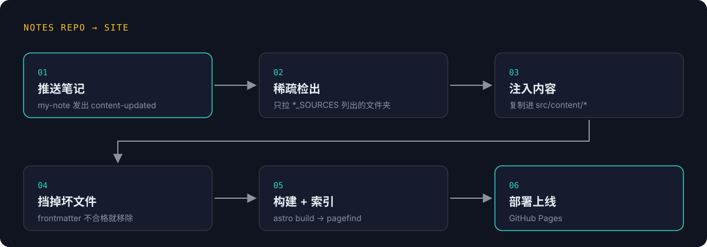
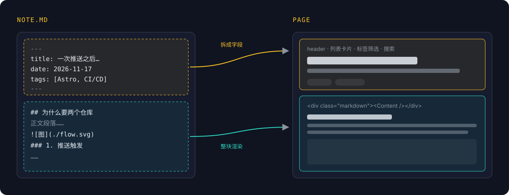

# 一次推送之后发生了什么:笔记仓库到网站的六步

## 为什么要两个仓库

笔记和网站的变化节奏完全不同:笔记几乎每天都在加,网站代码几周才动一次。
放在一起的话,每次改样式的提交都会夹在一堆笔记提交中间,历史很难读;
反过来,写笔记时也不想看到 `node_modules` 和组件代码。

所以拆成两个仓库:

| 仓库 | 放什么 | 谁在改 |
| --- | --- | --- |
| `my-note` | Markdown 笔记、项目介绍、资讯、截图 | 每天手写 |
| `my-portfolio` | Astro 模板、组件、样式、部署流程 | 偶尔改设计 |

> 内容只负责「写什么」,网站只负责「怎么展示」。两边都不需要知道对方的细节。

## 整体流程



### 1. 推送触发

笔记仓库推送后,它自己的 workflow 向网站仓库发一个 `repository_dispatch`,
事件类型是 `content-updated`。网站仓库只认这个事件、手动触发、和自己 `main` 的推送:

```yaml
on:
  repository_dispatch:
    types: [content-updated]
  workflow_dispatch:
  push:
    branches: [main]
```

跨仓库触发需要一个有权限的 token,这一步单独记在另一篇笔记里。

### 2. 只拉需要的文件夹

笔记仓库里还有草稿、面试准备之类不想公开的东西。用 sparse checkout 只拉列出来的文件夹,
**没列出来的永远不会到达网站**:

```yaml
NOTES_SOURCES: |
  notes
PROJECTS_SOURCES: |
  project
```

一行一个文件夹很重要 —— 这个列表是直接交给 git sparse-checkout 的,它按行读取。

### 3. 注入内容

把拉下来的文件夹复制进 `src/content/notes`、`src/content/projects` 等目录。
笔记和资讯会先清空再复制(笔记仓库是唯一来源);项目不清空,
因为网站仓库里本身也有项目条目(比如这个网站自己)。

如果列出的文件夹不存在或者是空的,这一步**直接失败**:
「Notes 区悄悄变空然后上线」比「这次不部署」糟糕得多。

### 4. 挡掉坏文件

Astro 遇到第一个 frontmatter 不合格的条目就会中止整个构建。
笔记是手写的,漏个 `date` 很正常,不能因为一篇笔记让整个网站下线。

所以构建前先跑一遍 `npm run check:content`:把缺少必填字段的文件移出去,
在 Actions 里留下警告,其余内容照常部署。

### 5. 构建与搜索索引

```bash
astro build && pagefind --site dist
```

Astro 输出静态页面后,Pagefind 扫描 `dist` 生成搜索索引。
搜索完全在浏览器里运行,不需要服务器。

### 6. 部署

上传 `dist` 到 GitHub Pages。如果第 4 步跳过了文件,部署完成后再让 workflow 变红 ——
网站已经更新了,但 GitHub 会发邮件提醒,坏掉的那篇不会被悄悄忽略。

## 一篇 md 是怎么变成页面的



### frontmatter 是数据

`title`、`date`、`tags`、`summary` 这些字段会被拆开,
分别出现在页头、列表卡片、标签筛选和搜索结果里。
它们先经过 `content.config.ts` 里的 schema 校验,所以字段名写错会在构建时报错,而不是在页面上默默消失。

### 正文整块渲染

正文会整段转成 HTML,塞进模板里的 `<Content />`。模板无法挑出「第三张图」单独处理 ——
这也是为什么图片的淡入、放大是对 `.markdown img` 全局生效,而不是写在笔记里。

另外,正文第一行如果是和标题重复的 `# 标题`,渲染时会自动去掉,
笔记在 Obsidian 里照样有标题,网站上也不会出现两次。

## 踩过的坑

### git 不追踪空文件夹

`src/content/notes` 在网站仓库里可能根本不存在,checkout 之后要先 `mkdir -p`,否则复制会失败。

### 一篇坏笔记拖垮全站

如果没有第 4 步,一篇 `date` 写成 `2026-13-01` 的笔记就会让整次构建失败,
连 About 页的改动都发不出去。有了它,坏文件只会让自己缺席。

## 一句话

两个仓库各管一件事,中间的流水线负责「只拿该拿的、挡住坏的、出错要响」。
